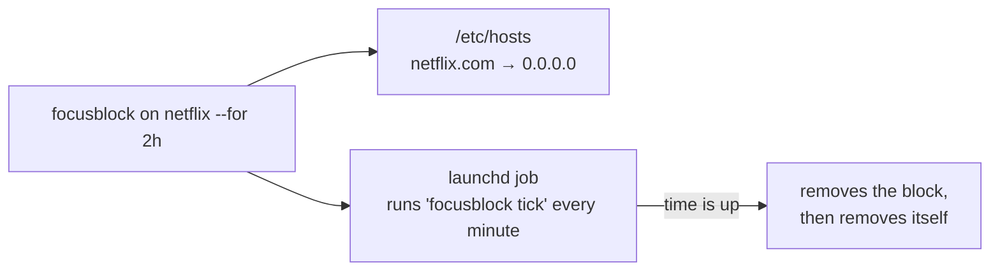

# focusblock

[](https://github.com/daffamzidan/focusblock/actions/workflows/ci.yml)

Build your focus, one session at a time. Decide what you'll work on and for how long, and focusblock keeps distracting sites closed until the session is done.

```console
$ sudo focusblock on netflix youtube --for 2h
Blocked: netflix, youtube
Locked until 2026-11-13 12:17. It will unblock itself then.
Restart your browser so it drops cached connections.

$ focusblock status
Blocked: netflix, youtube (21 domains)
Locked until 2026-11-13 12:17 (2h 00m left)

$ sudo focusblock off
focusblock: locked until 2026-11-13 12:17 (2h 00m left). Stay strong.
```

## Why I built this

I believe focus is a skill you can train. Willpower grows the same way fitness does: set a clear goal, commit to it, and follow through, again and again. I wanted a tool that supports that habit and makes each focus session count.

focusblock works as a commitment device. You make the decision once, at the start, while your goals are clear: "two hours on this project, no Netflix." From then on you spend that energy on the work instead of arguing with yourself. When the session ends, the block lifts by itself, and the break feels earned. Each session you finish is practice, so you can start with 25 minutes and build up to whole afternoons.

I kept it simple on purpose. It's one shell script that uses tools macOS already has, with no app to install, no account and no browser extension.

## Install

```bash
git clone https://github.com/daffamzidan/focusblock.git
cd focusblock
sudo make install        # puts focusblock in /usr/local/bin
```

To remove it, run `sudo make uninstall`. You can also run `bin/focusblock` straight from the repo without installing.

## Usage

| Command | What it does |
| --- | --- |
| `sudo focusblock on netflix` | Block Netflix until you turn it off |
| `sudo focusblock on netflix youtube --for 2h` | Block both, and refuse to unblock for 2 hours |
| `sudo focusblock on example.com` | Block any domain (the `www.` version is added for you) |
| `sudo focusblock off` | Remove the block, unless a timer is still running |
| `focusblock status` | Show what's blocked and how long is left |
| `focusblock lists` | Show the built-in lists |
| `focusblock --dry-run on reddit` | Preview the change without touching anything |

Durations look like `45m`, `2h`, `1h30m` or `1d`. Running `on` again adds sites to the block you already have. A new timer can make the lock **longer, never shorter**.

Built-in lists: `netflix`, `youtube`, `tiktok`, `instagram`, `x`, `reddit`. Each one is a plain text file in [`lists/`](lists). To add a site, add a file with one domain per line.

## How it works



- **Blocking.** Before asking DNS, macOS looks in `/etc/hosts`. focusblock points each blocked domain to `0.0.0.0` (IPv4) and `::` (IPv6), so the browser can't connect. Then it flushes the DNS cache so the change works right away.
- **Safe edits.** Everything focusblock writes sits between `# FOCUSBLOCK-START` and `# FOCUSBLOCK-END` markers. Turning it off gives back your original file byte for byte, and the tests check this. A copy of the original is also saved in `/var/db/focusblock/hosts.backup` the first time it runs.
- **The timer.** `--for` installs a small launchd daemon that runs `focusblock tick` every minute and at boot, so restarting the Mac doesn't end the block early. When time is up, the daemon removes the block and then removes itself. It runs a root-owned copy of the script from `/var/db/focusblock`, because launchd can't run scripts from `~/Downloads` or `~/Documents` (macOS privacy rules) and the copy keeps working even if you move the repo.
- **Input checks.** Site names go into a system file as root, so anything that isn't a plain hostname (letters, digits, dots, hyphens) is rejected before anything is written.

## Limits

focusblock supports your commitment. It isn't a security lock, and a determined admin can get around it:

- Anyone with your admin password can edit `/etc/hosts` by hand and remove the block. The timer only stops `focusblock off`. It can't stop someone with root access.
- It only covers this Mac. Your phone, tablet and TV can still open the sites.
- Browsers that use their own DNS, such as **Firefox with DNS over HTTPS**, skip `/etc/hosts`. Safari and Chrome follow it.
- Apps that connect straight to an IP address, or through a VPN with its own DNS, may get through.

## Development

```bash
brew install bats-core shellcheck
make test    # 29 bats tests, all run against a throwaway hosts file
make lint    # shellcheck
```

The tests never touch the real system. Environment variables (`FOCUSBLOCK_HOSTS`, `FOCUSBLOCK_STATE_DIR`, `FOCUSBLOCK_NOW` and more) point the script at temp files and a fake clock, so timer expiry can be tested without waiting. CI runs ShellCheck and the full suite on macOS and Ubuntu.

The script targets the **bash 3.2 that ships with macOS**, so it doesn't use associative arrays, `mapfile` or `${var,,}`. It also avoids `sed -i`, which works differently on BSD and GNU.

## License

[MIT](LICENSE)
